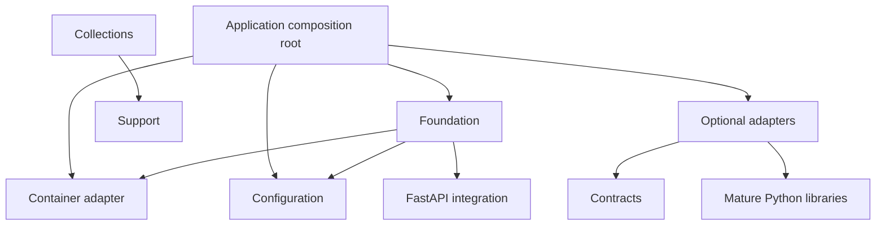
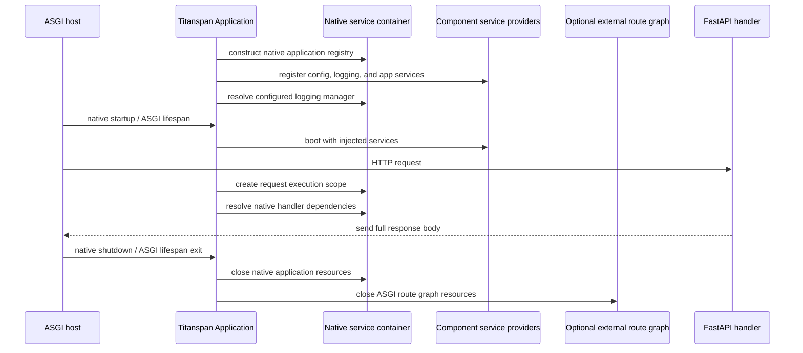

# Titanspan Architecture

## Vision

Titanspan is an independent, convention-driven, async-first Python framework.
It owns the developer-facing APIs, lifecycle, integration conventions, and
testing experience. Mature libraries provide the underlying web server,
dependency resolution, persistence, and workflow execution.

Async-first does not mean async-only: pure computation, object construction,
dependency registration, and sync-safe in-memory resolution remain
synchronous. Operations that require asynchronous I/O or lifecycle work have
explicit async interfaces.

The current package is intentionally small. The implemented foundation is a
FastAPI-backed ASGI application, a Dishka-backed container, a native
configuration repository with Pydantic Settings validation, a Typer CLI,
selected Support utilities, standalone eager and lazy Collections, native
logging, and an initial native HTTP component. Other modules below remain
planned boundaries unless marked as implemented in the table.

## Architectural principles

- Prefer composition and typed contracts over deep inheritance trees.
- Keep infrastructure adapters behind module-owned interfaces.
- Use one canonical `snake_case` name per public operation. Components may
  re-export shared contract objects, but must not create compatibility aliases
  or duplicate protocol identities.
- Keep core modules independent of optional AI, database, queue, and storage
  integrations.
- Make resource ownership and asynchronous operations explicit.
- Keep backend APIs behind explicit interoperability boundaries. Ordinary
  application APIs use Titanspan-owned contracts and domain types.
- Validate meaningful behavior with focused tests and integration tests.
- Avoid global mutable service instances and unbounded task creation.

## Component organization

Components live in domain-oriented packages under `src/titanspan/`. Each
implemented component exposes a deliberate `__init__.py` surface and owns
concrete behavior under its package. Use `service_provider.py` for component
registration when that lifecycle exists, `manager.py` for shared component
coordination, `drivers/` for independently selectable destinations,
`exceptions.py` for native errors, `events.py` for component events, and
`testing/` for fakes and assertions. These are conventions, not empty-file
requirements; create a subpackage only when the implementation needs it.

Place shared structural interfaces in domain packages under
`titanspan.contracts`: `config`, `container`, `logging`, and `support` are
currently established. A component may re-export the identical contract
object from its own public package. Implementation-only protocols remain with
their owner. Private third-party adapters live in the owning component's
`_backends/`; cohesive private helpers may live in `_internal/`. Do not make
contracts import concrete services to avoid a cycle; move the shared value or
contract to a dependency-safe location instead.

Facades are context-bound entry points for application-owned services.
`Config` and `Log` inherit one typed `Facade` base, declare the canonical
service contract they resolve, and keep explicit methods for static
discoverability. Their `use` and fake helpers are temporary execution-local
test overrides; production resolution uses the active application container.
Known public interoperability boundaries and remaining backend exposure are
tracked in [`docs/specifications/backend-boundaries.md`](docs/specifications/backend-boundaries.md).

## Module boundaries

| Module | Responsibility | Status |
| --- | --- | --- |
| `foundation` | Application lifecycle, bootstrapping, kernels, shutdown, and provider lifecycle. | `Application` owns native startup and shutdown independently of its ASGI adapter. |
| `container` | Dependency injection, bindings, concrete graph discovery, scopes, and resource management. | Native sync-first container composes framework services and supplies request-scoped HTTP dependencies; a private adapter remains for explicit external route providers. See `docs/specifications/container.md`. |
| `contracts` | Dependency-independent typed protocols and shared abstraction boundaries. | Initial configuration, sync-first and async container, and Support contracts implemented; many component contracts remain pending. |
| `support` | Shared utilities, managers, and lightweight helpers. | Selected native utilities implemented; see `docs/specifications/support.md`. |
| `config` | Typed configuration, trusted sources, environment integration, and safe snapshots. | Native repository, settings, source loader, cache, commands, and application provider implemented; see `docs/config/`. |
| `facades` | Context-aware access to application-owned services. | Shared typed facade base and execution-local `Config` and `Log` facades implemented. |
| `routing` | Application-owned route registration, groups, matching, controller dispatch, URL generation, and HTTP integration. | Initial component implemented against one route catalog; see `docs/specifications/routing.md` for verified and pending capabilities. |
| `http` | Incoming ASGI requests, native responses, middleware, streaming, and pooled outgoing clients. | Initial component implemented and application-integrated; pending behavior is listed in `docs/specifications/http.md`. |
| `auth` | Authentication, authorization, guards, gates, and policies. | Planned. |
| `database` | SQLAlchemy-backed models, queries, transactions, migrations, and persistence. | Planned. |
| `collections` | Typed eager and lazy APIs over ordinary Python iterables. | Eager and lazy value APIs are implemented. The component depends on Support and does not require Application or Container. Async iteration remains planned elsewhere. |
| `cache` | Caching, locks, expiration, and backend adapters. | Planned. |
| `concurrency` | Structured asynchronous concurrency, bounded pools, and cancellation. | Planned. |
| `parallel` | CPU-bound multiprocessing and parallel computation. | Planned. |
| `pipeline` | Composable streaming and concurrent transformations. | Planned. |
| `events` | Event dispatching, listeners, and subscribers. | Planned. |
| `queue` | Distributed jobs, workers, retries, chains, and batches. | Planned. |
| `mail` | Mailables, delivery, templates, and attachments. | Planned. |
| `notifications` | Multi-channel application notifications. | Planned. |
| `filesystem` | Local and cloud storage abstractions. | Planned. |
| `logging` | Native records, channels, drivers, redaction, context, async dispatch, and lifecycle. | Initial component implemented; see `docs/logging/` and its specification for limits. |
| `scheduling` | Recurring tasks, cron expressions, and coordination. | Planned. |
| `console` | CLI commands, generators, and scaffolding. | Initial help and version options implemented. |
| `ai` | Model providers, prompts, embeddings, and structured output. | Planned. |
| `agents` | Agent definitions, execution policies, and lifecycle. | Planned. |
| `workflows` | Typed stateful orchestration over LangGraph. | Planned. |
| `tools` | Agent tools, validation, authorization, and MCP integration. | Planned. |
| `memory` | Conversation memory, semantic memory, and persistent state adapters. | Planned. |
| `streaming` | Async streams, server-sent events, WebSockets, and incremental output. | Planned. |
| `telemetry` | Metrics, tracing, and runtime instrumentation. | Planned. |
| `testing` | Application test cases, fakes, assertions, and test utilities. | Planned. |

## Dependency direction

The application composition root wires providers and adapters. Core modules
should depend on contracts and framework primitives. Optional adapters may
depend on core contracts and their selected libraries, but framework core must
not import those adapters.

Avoid circular imports. Shared types belong in narrow contract modules; do not
solve cycles with broad imports from the package root. The package root exports
only `Application` and `__version__` today.

## Application lifecycle

`Application` is the composition root for framework-owned services. It loads
trusted configuration, creates the native `Container`, registers the
configuration and logging providers followed by application providers, then
resolves the configured `LoggingManager` from that same container. Direct
application resolution, Config and Log facades, helper access, and provider
boot dependencies therefore share service identities.

The caller can include FastAPI routers through the deliberate
`application.asgi` integration boundary. `Application.dependency` resolves
native services through the active application container. An optional private
graph remains for explicitly supplied external route providers. Native
`Application.startup` and `Application.shutdown` work without HTTP hosting;
the ASGI lifespan delegates to them. Pure ASGI request middleware keeps
application context, request scope, and logging context active through the
complete response send, including streaming bodies. See the [backend boundary
audit](docs/specifications/backend-boundaries.md) for the remaining raw
provider interoperability input.

Construct and validate production registrations before serving traffic. Do not
mutate shared registrations after boot. The current integration does not add a
builder DSL, service-provider discovery, or implicit module scanning.

## Service container and execution scopes

The native container owns framework service registration and task-local scope
contexts. Its private dependency adapter composes graphs and delegates
construction and resource finalization. Concrete class graphs can be
discovered on demand and are cached by root until application or scope
shutdown. Registration freezes when graph composition starts. The current
adapter maps semantic scope names onto a finite ordered hierarchy; see the
specification for equivalent-level and nesting limits. Native FastAPI
dependencies use the application container. Explicit external route
providers may still use a separate interoperability graph.

Application-scoped objects may be shared only when they are safe for concurrent
use. Mutable sessions and request data belong to narrower scopes. Facades, if
added, must resolve through the active execution context rather than global
mutable state. Shutdown must cancel or drain owned work before closing shared
resources.

## Adapters and contracts

Contracts describe framework-owned behavior with typed protocols or small
abstract interfaces. Adapters translate those contracts to libraries such as
SQLAlchemy, Taskiq, Cashews, or LangGraph. Ordinary application APIs use
Titanspan-owned types; native library objects are exposed only at explicit,
documented interoperability boundaries.

Shared interfaces are organized under `titanspan.contracts.config`,
`titanspan.contracts.container`, `titanspan.contracts.foundation`,
`titanspan.contracts.logging`, and `titanspan.contracts.support`. The top-level
contracts package re-exports those exact objects. `config.Repository`
implements `ConfigRepository`; ConfigServiceProvider registers the selected
repository through `ServiceRegistry`. LoggingServiceProvider builds the
application manager from that contract and registers `LoggingManager` and
`LogWriter`. `container.Container` implements `ServiceContainer` and is the
registry used by Application and the shared facade base. Logging implements
the shared generic driver, formatter, processor, and customizer contracts
without importing concrete log records into the contracts package.

The package dependency order places `titanspan.contracts` below configuration
and core service modules. Contracts use Python's standard typing facilities
and do not import concrete modules, optional database, AI, queue, or storage
adapters.
The implemented native contracts, owners, and deferred boundaries are
recorded in [`docs/specifications/contracts.md`](docs/specifications/contracts.md).

Configuration source precedence and security boundaries are recorded in
[ADR 0013](docs/architecture/decisions/0013-native-configuration.md). The
Pydantic Settings backend stays private; trusted file loading, source
precedence, secret-safe diagnostics, and JSON cache behavior are owned by
Titanspan.

An adapter should not duplicate the library's engine, query compiler, worker
system, or execution runtime. Add a contract only when it enables a real
substitution, test seam, or lifecycle boundary.

The logging component follows this rule explicitly. Public `Logger`,
`LogManager`, `LogRecord`, `LogDriver`, formatter, processor, and event types
belong to Titanspan. The private `logging._backends` package adapts Structlog
and Python's standard logging handlers. Importing the component does not
configure the root logger. `Application` owns its manager, binds it to HTTP
request context, and closes it before the dependency container during
shutdown. The implementation is synchronous by default; explicit async
methods offload blocking sinks or await native async drivers. Configured
background dispatch is bounded and process-local.

## Async-first behavior

I/O-facing APIs should be asynchronous when the underlying operation supports
it. Do not hide asynchronous I/O behind property access or block the event loop
with CPU work. Use AnyIO for structured concurrency when that module is
implemented; always propagate cancellation and bound fan-out.

For large inputs, use iterators or streams, bounded queues, chunking, and
backpressure. Avoid creating one task per item for unbounded workloads. CPU
parallelism belongs in processes or native libraries that release the GIL;
distributed jobs belong in a queue adapter.

## Database and transaction semantics

The planned persistence layer uses SQLAlchemy for statements, sessions, and
Unit of Work behavior. An Active Record-style convenience layer must preserve
native SQLAlchemy statements and sessions. Transactions remain explicit and
predictable; model operations participate in the active transaction.

Never share an unsafe mutable async session across concurrent tasks. Make
relationship loading explicit or eagerly loaded before access. Large query
results should support incremental consumption, and bulk operations should not
instantiate unnecessary ORM objects. SQL parameters must be bound safely.

## AI workflows

LangGraph is the planned graph execution engine. Titanspan may add typed state,
node conventions, reducers, authorization, testing helpers, and checkpoint
configuration around it. Durable checkpoints should contain serializable
workflow state, not live dependency containers, sessions, or open connections.

Workflow checkpoints, conversation memory, and semantic memory are distinct
concepts. Interruptions, resumption, streaming, and human approvals must have
explicit state and authorization behavior.

## Errors and security

Preserve exception causes and propagate cancellation. Translate exceptions at
well-defined framework boundaries and include enough context for diagnosis
without logging credentials or private payloads.

Validate untrusted configuration and tool inputs. Bind database parameters,
authorize agent tools, avoid leaking secrets in logs, and keep authentication
and authorization adapters replaceable. Security-sensitive defaults must be
documented and tested before becoming public APIs.

## Testing strategy

Use Pytest with test-driven development for unit, integration, feature,
regression, security, performance, and stress coverage. Write the focused
failing test first for meaningful behavior changes and bug fixes. Cover public
contracts and actual behavior at each implemented dependency boundary; mocks
must not replace the behavior under test. Test scope isolation, cleanup after
success and failure, cancellation, timeouts, and concurrent execution where
applicable. Tests must not require paid services or live commercial model
APIs.

CI enforces at least 95% statement coverage and 90% branch coverage
independently for implemented first-party runtime code. Every Python module,
class, function, method, fixture, and test has strict typing and a physically
multi-line Google-style docstring. Implementation comments explain non-obvious
decisions and invariants. These policies are checked with Ruff, strict
Pyright, and the repository's read-only source checker; comment quality is
reviewed because it cannot be reliably inferred mechanically.

Performance measurements record the machine, operating system, Python and
dependency versions, workload, concurrency, throughput, latency distribution,
and peak memory. Shared GitHub runner timings are informational; do not use
them as strict performance gates.

## Extension and native interoperability

Applications will extend the framework through explicit providers, adapters,
routers, and typed contracts. Do not require a Titanspan wrapper when native
FastAPI, Dishka, SQLAlchemy, LangGraph, or other selected library APIs already
solve the problem clearly.
