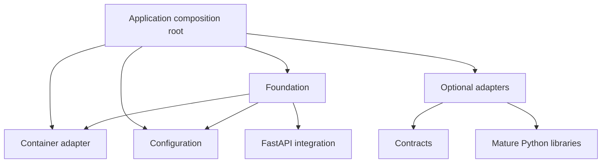
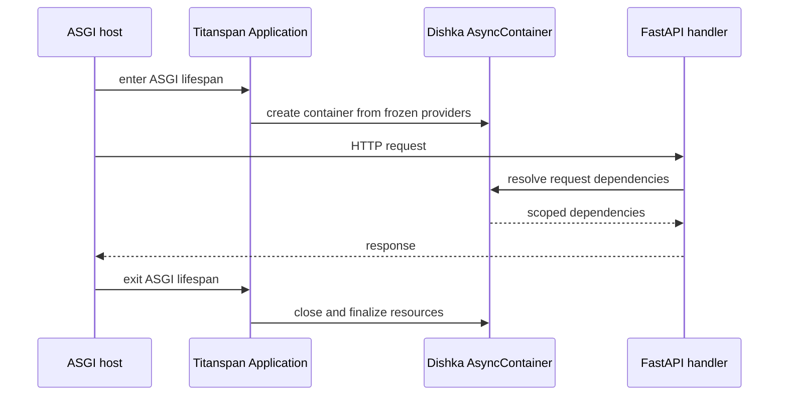

# Titanspan Architecture

## Vision

Titanspan is a convention-driven, async-first Python application framework.
It owns the developer-facing APIs, lifecycle, integration conventions, and
testing experience. Mature libraries provide the underlying web server,
dependency resolution, persistence, and workflow execution.

The current package is intentionally small. The implemented foundation is a
FastAPI-backed ASGI application, a Dishka async container, Pydantic Settings,
and a Typer CLI. Other modules below are planned boundaries, not supported
features.

## Architectural principles

- Prefer composition and typed contracts over deep inheritance trees.
- Keep infrastructure adapters behind module-owned interfaces.
- Keep core modules independent of optional AI, database, queue, and storage
  integrations.
- Make resource ownership and asynchronous operations explicit.
- Preserve native access to underlying libraries.
- Validate meaningful behavior with focused tests and integration tests.
- Avoid global mutable service instances and unbounded task creation.

## Module boundaries

| Module | Responsibility | Status |
| --- | --- | --- |
| `foundation` | Application lifecycle, bootstrapping, kernels, shutdown, and provider lifecycle. | Initial `Application` implemented. |
| `container` | Dependency injection, bindings, autowiring, scopes, contextual bindings, and resource management. | Dishka adapter implemented. |
| `contracts` | Typed service interfaces, protocols, and abstraction boundaries. | Planned. |
| `support` | Shared utilities, managers, and lightweight helpers. | Planned. |
| `config` | Typed configuration, environment variables, and configuration repositories. | Initial `Settings` implemented. |
| `facades` | Context-aware access to container-managed services. | Planned. |
| `routing` | Fluent routing, route groups, controllers, and workflow endpoints. | Planned; FastAPI routers remain directly accessible. |
| `http` | HTTP requests, responses, middleware, and fluent HTTP clients. | Planned. |
| `auth` | Authentication, authorization, guards, gates, and policies. | Planned. |
| `database` | SQLAlchemy-backed models, queries, transactions, migrations, and persistence. | Planned. |
| `collections` | Eager, lazy, and asynchronous fluent collections. | Planned. |
| `cache` | Caching, locks, expiration, and backend adapters. | Planned. |
| `concurrency` | Structured asynchronous concurrency, bounded pools, and cancellation. | Planned. |
| `parallel` | CPU-bound multiprocessing and parallel computation. | Planned. |
| `pipeline` | Composable streaming and concurrent transformations. | Planned. |
| `events` | Event dispatching, listeners, and subscribers. | Planned. |
| `queue` | Distributed jobs, workers, retries, chains, and batches. | Planned. |
| `mail` | Mailables, delivery, templates, and attachments. | Planned. |
| `notifications` | Multi-channel application notifications. | Planned. |
| `filesystem` | Local and cloud storage abstractions. | Planned. |
| `logging` | Structured and contextual application logging. | Planned. |
| `scheduling` | Recurring tasks, cron expressions, and coordination. | Planned. |
| `console` | CLI commands, generators, and scaffolding. | Initial help and version options implemented. |
| `ai` | Model providers, prompts, embeddings, and structured output. | Planned. |
| `agents` | Agent definitions, execution policies, and lifecycle. | Planned. |
| `workflows` | Typed stateful orchestration over LangGraph. | Planned. |
| `tools` | Agent tools, validation, authorization, and MCP integration. | Planned. |
| `memory` | Conversation memory, semantic memory, and persistent state adapters. | Planned. |
| `streaming` | Async streams, server-sent events, WebSockets, and incremental output. | Planned. |
| `telemetry` | Metrics, tracing, and runtime instrumentation. | Planned. |
| `testing` | Application test cases, fakes, assertions, and test utilities. | Planned. |

## Dependency direction

The application composition root wires providers and adapters. Core modules
should depend on contracts and framework primitives. Optional adapters may
depend on core contracts and their selected libraries, but framework core must
not import those adapters.

Avoid circular imports. Shared types belong in narrow contract modules; do not
solve cycles with broad imports from the package root. The package root exports
only `Application` and `__version__` today.

## Application lifecycle

`Application` creates a FastAPI application and a Dishka `AsyncContainer` from
the provided registrations. The caller can include native FastAPI routers via
`application.asgi`. Dishka's FastAPI integration manages request scopes, and
the application lifespan closes the app-scoped container in a `finally`
block.

Construct and validate production registrations before serving traffic. Do not
mutate shared registrations after boot. The current integration does not add a
builder DSL, service-provider discovery, or implicit module scanning.

## Service container and execution scopes

Dishka owns graph resolution and resource finalization. Titanspan may later
provide conventions for transient, application, request, connection, job,
workflow, node, agent, and tool lifetimes. These are separate execution
lifecycles, not necessarily one linear scope hierarchy.

Application-scoped objects may be shared only when they are safe for concurrent
use. Mutable sessions and request data belong to narrower scopes. Facades, if
added, must resolve through the active execution context rather than global
mutable state. Shutdown must cancel or drain owned work before closing shared
resources.

## Adapters and contracts

Contracts describe framework-owned behavior with typed protocols or small
abstract interfaces. Adapters translate those contracts to libraries such as
SQLAlchemy, Taskiq, Cashews, or LangGraph. Keep native library objects
accessible so users can opt out of a Titanspan convenience API when necessary.

An adapter should not duplicate the library's engine, query compiler, worker
system, or execution runtime. Add a contract only when it enables a real
substitution, test seam, or lifecycle boundary.

## Async-first behavior

I/O-facing APIs should be asynchronous when the underlying operation supports
it. Do not hide asynchronous I/O behind property access or block the event loop
with CPU work. Use AnyIO for structured concurrency when that module is
implemented; always propagate cancellation and bound fan-out.

For large inputs, use iterators or streams, bounded queues, chunking, and
backpressure. Avoid creating one task per item for unbounded workloads. CPU
parallelism belongs in processes or native libraries that release the GIL;
distributed jobs belong in a queue adapter.

## Database and transaction semantics

The planned persistence layer uses SQLAlchemy for statements, sessions, and
Unit of Work behavior. An Active Record-style convenience layer must preserve
native SQLAlchemy statements and sessions. Transactions remain explicit and
predictable; model operations participate in the active transaction.

Never share an unsafe mutable async session across concurrent tasks. Make
relationship loading explicit or eagerly loaded before access. Large query
results should support incremental consumption, and bulk operations should not
instantiate unnecessary ORM objects. SQL parameters must be bound safely.

## AI workflows

LangGraph is the planned graph execution engine. Titanspan may add typed state,
node conventions, reducers, authorization, testing helpers, and checkpoint
configuration around it. Durable checkpoints should contain serializable
workflow state, not live dependency containers, sessions, or open connections.

Workflow checkpoints, conversation memory, and semantic memory are distinct
concepts. Interruptions, resumption, streaming, and human approvals must have
explicit state and authorization behavior.

## Errors and security

Preserve exception causes and propagate cancellation. Translate exceptions at
well-defined framework boundaries and include enough context for diagnosis
without logging credentials or private payloads.

Validate untrusted configuration and tool inputs. Bind database parameters,
authorize agent tools, avoid leaking secrets in logs, and keep authentication
and authorization adapters replaceable. Security-sensitive defaults must be
documented and tested before becoming public APIs.

## Testing strategy

Use Pytest for unit, integration, feature, performance, and stress coverage.
Test public behavior, scope isolation, cleanup after success and failure,
cancellation, and concurrent execution. Use fakes only at integration
boundaries. Tests must not require paid services or live commercial model APIs.

Performance measurements record the machine, operating system, Python and
dependency versions, workload, concurrency, throughput, latency distribution,
and peak memory. Shared GitHub runner timings are informational; do not use
them as strict performance gates.

## Extension and native interoperability

Applications will extend the framework through explicit providers, adapters,
routers, and typed contracts. Do not require a Titanspan wrapper when native
FastAPI, Dishka, SQLAlchemy, LangGraph, or other selected library APIs already
solve the problem clearly.

