# Continuous integration

Titanspan's primary GitHub Actions workflow keeps the required checks visible
as independent jobs. It runs on pushes, pull requests, merge queues, and
manual dispatch. It has no path filters, so every required status is reported
for every change. Pull-request runs are cancelled only when a newer run for
the same request supersedes them.

## Primary workflow

`.github/workflows/ci.yml` contains four stages:

1. **Independent static checks** run in parallel: Ruff lint, Ruff format,
   docstrings, comments, technical documentation, line length, Python syntax,
   strict Pyright, architecture boundaries, public API checks, agent
   configuration, lockfile, and Actions workflow policy and syntax.
2. **Tests and verification** run after static checks: a dedicated
   cross-component architecture integration job, unit and integration suites
   on Python 3.12 through 3.15, plus separately visible feature, regression,
   concurrency, security, and component API suites.
   Separate dependency audit, secret scan, license audit, CodeQL, package
   build, Docker/Compose, and documentation jobs verify other boundaries.
3. **Runtime checks** install the exact wheel produced by the build job into
   clean environments, then verify minimal and optional installations, the
   installed CLI, and an application startup/HTTP/shutdown lifecycle.
4. **Coverage aggregation** combines only the canonical Linux/Python 3.12
   reports from all required test groups. It rejects missing artifacts and
   separately enforces at least 95% line and 90% branch coverage.

The graph below groups the independent jobs for readability. Every test job
depends directly on every static-check job listed in its workflow `needs`.
The final gate depends directly on each mandatory job, including jobs in later
stages; the grouped labels below are not Actions jobs.

```mermaid
flowchart TD
  subgraph Static[Independent static and policy jobs]
    lint[Lint]
    format[Format]
    docs[Docblocks]
    comments[Comments]
    technical[Technical documentation]
    lines[Line length]
    syntax[Syntax]
    types[Strict types]
    architecture[Architecture]
    api[Public API]
    agents[Agent configurations]
    lock[Locked dependencies]
    workflows[Workflow policy and actionlint]
  end

  subgraph Tests[Tests on Linux, Python 3.12 to 3.15]
    crossComponent[Contract and lifecycle integration]
    unit[Unit matrix]
    integration[Integration matrix]
    feature[Feature tests]
    regression[Regression tests]
    concurrency[Concurrency tests]
    security[Security tests]
    componentApi[Support and logging component APIs]
  end

  staticSummary[All 13 static jobs succeed]
  lint --> staticSummary
  format --> staticSummary
  docs --> staticSummary
  comments --> staticSummary
  technical --> staticSummary
  lines --> staticSummary
  syntax --> staticSummary
  types --> staticSummary
  architecture --> staticSummary
  api --> staticSummary
  agents --> staticSummary
  lock --> staticSummary
  workflows --> staticSummary
  staticSummary --> unit
  staticSummary --> integration
  staticSummary --> crossComponent
  staticSummary --> feature
  staticSummary --> regression
  staticSummary --> concurrency
  staticSummary --> security
  staticSummary --> componentApi

  lock --> platform[macOS and Windows API smoke]
  lock --> dependencies[Dependency audit]
  lock --> secrets[Secret scan]
  lock --> licenses[License compliance]
  lock --> codeql[CodeQL]
  lock --> build[Wheel and source build]
  lock --> docker[Docker and Compose smoke]
  lock --> docsBuild[VitePress build]
  build --> install[Clean installation]
  build --> cli[Installed CLI]
  build --> app[Installed app lifecycle]

  unit --> coverage[Separate line and branch coverage]
  integration --> coverage
  feature --> coverage
  regression --> coverage
  concurrency --> coverage
  security --> coverage
  componentApi --> coverage
  api --> coverage
  crossComponent --> coverage

  unit --> gate[Gate: All mandatory CI checks]
  integration --> gate
  feature --> gate
  regression --> gate
  concurrency --> gate
  security --> gate
  componentApi --> gate
  crossComponent --> gate
  coverage --> gate
  platform --> gate
  dependencies --> gate
  secrets --> gate
  licenses --> gate
  codeql --> gate
  build --> gate
  install --> gate
  cli --> gate
  app --> gate
  docker --> gate
  docsBuild --> gate
  staticSummary --> gate
```



The `ci-gate` uses `if: always()` and validates the complete direct `needs`
result mapping. It fails for failed, cancelled, skipped, missing, unexpected,
or malformed mandatory job results. It does not treat a missing status as
success. If the entire workflow is cancelled before the gate can run, required
repository status checks must still reject missing or pending results.

## Compatibility and platform support

The primary Linux test matrix covers Python 3.12, 3.13, 3.14, and 3.15, as
declared by `requires-python` and verified against the locked dependency set.
Pull requests also run representative Python 3.12 API smoke tests on macOS and
Windows. `.github/workflows/compatibility.yml` runs the full unit suite across
all three hosted operating systems and all four supported Python versions on
a weekly schedule or manual dispatch.

Linux is the fully exercised primary CI platform. macOS and Windows receive
unit/runtime verification; infrastructure-backed integration behavior is
currently exercised on Linux. Platform support remains subject to each
dependency's actual capabilities.

## Test groups and coverage

Pytest markers separate unit, integration, feature, regression, concurrency,
security, performance, and stress checks. The Support and logging API job
runs their focused component suites. Primary test jobs emit JUnit summaries
and artifacts.

Coverage is collected for each required test group on Linux/Python 3.12 and
uploaded separately. The aggregate job validates the exact artifact
inventory, combines compatible branch data, then independently checks line
and branch thresholds. It also checks that at least 95% of changed lines in
`src/titanspan/` have coverage. This uses a source-only diff against the pull
request base, the previous push commit, or the first parent for a manual run.
The configured thresholds must not be lowered to accommodate new code.

## Security and reproducibility

CI defaults to read-only repository permissions. Jobs request additional
permissions only for CodeQL or explicitly scoped workflows. Third-party
Actions are pinned to verified immutable commit SHAs with release annotations.
Python installation, dependency resolution, tests, and builds use the pinned
uv release and `uv.lock`. Checkout credentials are disabled where Git access
is not needed. Pull-request code does not run under `pull_request_target` or
receive publishing credentials.

The primary workflow audits locked dependencies, scans tracked files for
secrets, checks dependency license metadata against the reviewed policy, and
runs CodeQL. No production credentials, paid AI APIs, or paid infrastructure
are required.

## Package and runtime validation

The build job creates a wheel and source distribution, validates metadata and
archive contents, checks the distributions with Twine, and uploads them as a
short-lived artifact. Clean-install jobs consume that exact wheel outside the
checkout and verify the minimal and implemented `numbers` extra profiles.
Development instructions, skills, and CI scripts are checked for accidental
inclusion. The runtime smoke uses the installed package for an ASGI lifespan
and real in-process HTTP request. Docker CI validates Compose, builds the
non-root image, and exercises the installed CLI; it does not start unused
database or Redis services.

## Documentation and additional workflows

The primary CI workflow checks maintained Markdown, Python comments, and
docstrings in the independently visible technical-documentation job. It
installs Vale v3.28.1 with a verified SHA-256 digest, then syncs the pinned
Std rules and Python grammar. Terminology errors fail the job. Passive voice,
sentence length, spelling, word choice, and repeated words remain advisory.
The job reports those findings and fails on tool or configuration errors.

The primary CI workflow also validates and builds VitePress documentation.
`docs.yml` separately audits the documentation npm lockfile and deploys Pages
only for configured main-branch events. No custom domain is assumed.

`.github/workflows/performance.yml` runs scheduled or manually dispatched
informational benchmarks and stress checks. Benchmark JSON includes the
benchmark plugin's machine and measurement data, plus the installed
distribution versions, and is uploaded as an artifact. Shared-runner
wall-clock results do not have pass/fail timing thresholds. Add benchmarks
only for implemented paths and record reproducible workload and environment
metadata before making performance claims.

## Local commands

Install the locked development environment with `uv sync --locked --all-groups`
and use GNU Make for the same checks used by CI:

```bash
make vale-install
make vale-sync
make prose-check
make terminology-check
make prose-test
make lint
make format-check
make docs-check
make comments-check
make line-length-check
make syntax-check
make types
make architecture-check
make architecture-integration-test
make agents-check
make workflows-check
make unit-test
make integration-test
make component-api-test
make coverage
make check
make ci
```

`make check` is read-only and runs the local mandatory quality suite.
`make ci` adds dependency, secret, license, docs, package, Docker, and hook
checks without running the complete test suite a second time. Use
`make stress-test` and `make benchmark` for explicit informational runs.

## Troubleshooting and maintenance

- If `uv lock --check` fails, update dependency declarations using `uv lock`
  locally and include the resulting `uv.lock` change.
- If the fail-closed gate reports a skipped job, inspect its prerequisite and
  repair the earlier stage; do not add `continue-on-error` or weaken the gate.
- If coverage artifacts are missing, inspect the corresponding test job and
  upload step. The aggregate job intentionally fails closed.
- Run `make workflows-check` after workflow edits. It verifies YAML policy,
  immutable action references, job inventory, dependency graph, and actionlint.
- Review CI policy changes independently. Do not remove a job from the gate,
  relax coverage or typing, or suppress a failed verification.

## Release readiness

The manual release workflow builds and attests distributions. Publishing is
gated behind an explicit dispatch input, a version tag, the configured PyPI
Trusted Publisher, and a protected environment. Ordinary CI and pushes to
`main` never publish packages. Create a release only through an explicitly
authorized maintainer action after verifying the exact tagged commit and its
mandatory CI result.
