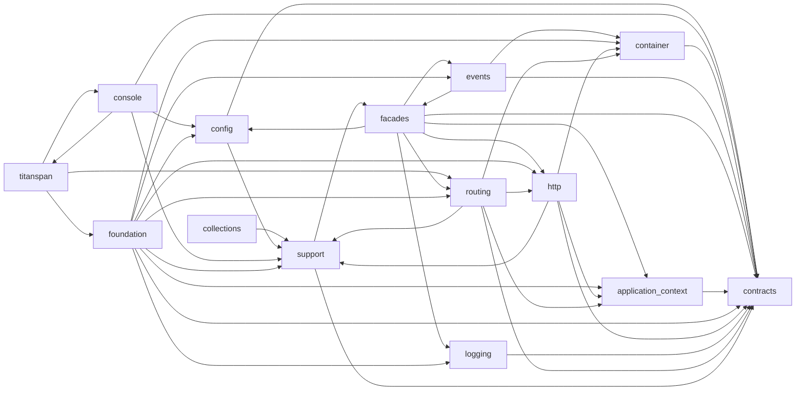

# Framework engineering review

## Scope and evidence

The historical source audit started at commit `2afcd31`. This continuation
reviewed main at `ad06e47`, including the HTTP implementation. It revalidated
URL generation and event subscriber ownership against production code and
tests. Findings distinguish reproduced defects from documented limits and
evidence gaps.

The lockfile pins Blinker 1.9.0, Dishka 1.10.1, FastAPI 0.165.0, and
Starlette 1.10.0. It also pins HTTPX2 2.16.2, Pydantic 2.14.4, Pydantic
Settings 2.16.3, Structlog 26.1.0, Tenacity 9.2.1, and Typer 0.29.2. This
review checked the APIs in their installed versions.

## Assessment

The implemented components use one application-owned container and route
catalog. They delegate dependency graph execution, HTTP protocol handling,
network pools, path matching, settings validation, structured logging, and
retry scheduling to selected libraries. Their native adapters add Titanspan
contracts, security rules, lifecycle ownership, and application integration.

This is a coherent foundation for current configuration, logging, events,
HTTP, and routing use. The worker-thread singleton race documented below is
resolved by an earlier focused correction. This pass also corrected URL
contract substitution, encoded route reversal, and event subscriber scope
retention. Semantic scope nesting remains limited by the backend hierarchy
and affects future workflow architecture.

## Import dependency graph

An AST scan of 198 source files found 520 internal module edges and 43
cross-component pairs. A second scan excluded `TYPE_CHECKING` blocks and
function-local imports. It found 461 module-scope edges and no import-time
cycles.

The following graph aggregates the complete internal import references. An
arrow points from an importing component to its dependency.

The graph groups private modules under their owning components. The
`application_context` node represents the private shared context module.
`events.helpers` imports the Event facade for application-bound helpers.
`support.helpers.config` does the same for configuration access. Both imports
are function-local; they do not create module initialization cycles. The
Console-to-package edge reads installed version metadata.

## Component readiness matrix

The matrix separates production integration evidence from isolated unit
coverage. Each component specification lists implemented and pending
capabilities in more detail.

| Component | Integration evidence | Current assessment |
| --- | --- | --- |
| Contracts | `docs/src/content/docs/architecture/contract-integration.md`; Pyright and contract resolution tests | Native service boundaries exist for implemented components. Some protocols remain optional extension points. |
| Support | `tests/integration/support/`; URI and Routing integration tests | Reusable utilities work independently. Application-bound `config()` and route-aware URI factories require active services. |
| Config | Framework cohesion tests and Config specification | The repository is substitutable and Foundation-owned. Settings inheritance still exposes backend methods. |
| Logging | Framework cohesion tests and Logging specification | The manager, logger contracts, configuration, facade, and shutdown use one application identity. Several backend branches have lower local coverage than core APIs. |
| Container | Container thread-safety and lifecycle integration tests | One graph and shared initialization gates protect supported sync and async paths. Request/workflow and node/agent lifetimes cannot overlap. |
| Facades | Framework cohesion and URI contract substitution tests | Facades resolve declared application contracts. They do not own a second service registry. |
| Foundation | Lifecycle tests in `tests/integration/test_framework_cohesion.py` | Startup, failure rollback, context, active-scope shutdown rejection, and retryable shutdown have real tests. |
| HTTP | ASGI, client, streaming, and request lifecycle integration tests | Server and client adapters use application services. Native SSRF destination enforcement remains pending. |
| Routing | Dispatch, URI integration, and URL generator tests | One catalog drives matching and reversal. Native custom converters and route-file discovery remain unsupported. |
| Collections | Collection unit tests and Hypothesis invariants | Eager and lazy operations use Python iterators and preserve documented order. Intersection checks every supplied iterable. |
| Events | Events application and dispatcher integration tests | Dispatch uses the application Container. Class subscribers now resolve handlers in the active scope; Blinker currently stores receivers. |
| Console | CLI tests and Foundation integration | Native registration, Container injection, and command lifecycle are implemented. Component-owned commands and generators remain pending. |

This evidence does not establish production readiness for distributed
execution, Windows, multiprocess pools, AI agents, or nested workflow scopes.

## Custom infrastructure review

| Component | Existing infrastructure | Custom behavior | Decision |
| --- | --- | --- | --- |
| Contracts | Python `Protocol`, `ABC`, and typing | Native service boundaries and domain values | Keep. These declarations provide dependency inversion and do not recreate engines. |
| Container | Dishka graph construction, validation, caching, and cleanup | Native bindings, discovery, contextual injection, overrides, scopes, and exception translation | Keep the adapter. Native policy adds framework behavior while Dishka retains graph and resource ownership. |
| Config | Pydantic Settings, `python-dotenv`, JSON, and TOML libraries | Repository semantics, source ordering, safe diagnostics, and cache validation | Keep. The repository and loader coordinate framework precedence and safe snapshots. Review the Settings inheritance exposure separately. |
| Logging | Structlog and Python logging handlers | Channels, redaction, context, bounded delivery, and application ownership | Keep. Titanspan owns policy and lifecycle; the backends own processing and sinks. |
| HTTP | Starlette, HTTPX2, AnyIO, and Tenacity | Native request and response contracts, body limits, client isolation, retry safety, and resource ownership | Keep narrow adapters. Do not duplicate parsing, pooling, scheduling, or ASGI transmission. |
| Routing | FastAPI and Starlette matching and route hosting | One route catalog, metadata, controller injection, URL generation, and constraints | Keep. The catalog supplies behavior that backend routes alone do not provide. |
| Events | Blinker receiver registry | Selectors, ordering, injection, sequential async dispatch, fakes, and bounded deferral | Keep native behavior; review Blinker’s limited role before API stabilization. |
| Collections | Python iterators, mappings, and equality operations | Ordered eager and lazy transformations, including unhashable values | Keep. Built-in sets cannot provide these ordering and equality guarantees. |
| Support | `urllib.parse`, `re`, `unicodedata`, `secrets`, and other standard modules | Native URI factories, nested data access, and composed string operations | Keep domain utilities. Avoid adding wrappers that only rename built-ins. Review three existing pass-through methods before the stable API. |
| Foundation | Starlette ASGI lifespan primitives and context variables | Application composition, provider order, request scope, and shutdown ownership | Keep. No selected dependency owns the complete Titanspan application lifecycle. |
| Facades | Active application context and Container | Explicit typed access to application-owned services | Keep the shared base. It delegates resolution and does not maintain another registry. |
| Console | Typer and Rich | Framework commands and output | Keep command integration; do not create another parser. |
| Test policy | Pytest and Vale | Category enforcement and Titanspan terminology rules | Keep the small checks. They enforce repository policies that the tools do not define. |

### Delegation corrections made during review

- HTTP retry scheduling now uses the existing Support helpers and Tenacity.
  HTTP-specific idempotency checks, status selection, and `Retry-After`
  handling remain in the HTTP component.
- The HTTP client now ignores response cookies in its shared cookie jar.
  Connection pools remain shared; cookie state does not cross requests.
- One bounded ASGI receiver now serves both the native Request and downstream
  ASGI application. This prevents a second protocol path from bypassing body
  limits.
- Stream iterators close before the request context exits after disconnect or
  cancellation. Starlette retains responsibility for ASGI transmission.
- Request builders snapshot mutable inputs. They do not create a second
  transport client or request execution engine.
- Routing continues to compile the canonical route catalog into FastAPI.
  Route constraints also apply to URL reversal and partial method matches.
- URL factories resolve one `UriUrlGenerator` contract. They share Support's
  query encoding and validate generated URLs against route matching.
- Class-based Event subscribers retain class and method metadata. Dispatch
  resolves each handler in its active execution scope.
- Collection intersection now checks membership in every supplied iterable.
  It retains first-seen order and supports unhashable values.
- Pytest collection rejects runtime tests without a recognized category.
  The check does not replace Pytest selection or coverage enforcement.

## Additional design review

### F-006 — Blinker is used as a receiver store, not the dispatch engine

**Severity:** P2 — design review; no behavior defect demonstrated.

**Affected components:** Events, dependency architecture.

**Evidence:** `src/titanspan/events/dispatcher.py:237` creates one
`OrderedSignal`. `dispatcher.py:275` connects every registration to that
signal. `dispatcher.py:918-931` reads all receivers, then Titanspan matches
selectors and orders listeners. The component does not call Blinker
`Signal.send()` or `Signal.send_async()`. `src/titanspan/events/_backends/blinker.py`
adds an ordered receiver set to retain registration order.

**Consequence:** Titanspan owns listener selection, ordering, injection,
results, propagation, and async execution. Blinker currently provides receiver
storage and connection operations. Its contribution may not justify the
adapter and dependency for this use.

**Recommendation:** Before stabilizing the Events API, compare this registry
use with a small ordered mapping. Keep Blinker only if receiver lifetime,
registration, or future signal delegation provides measurable value. Check
thread safety and removal during active dispatch before changing the design.

**Acceptance:** A focused proposal compares behavior, lock ownership,
registration cost, snapshot cost, and dependency impact. Tests preserve ordered
snapshots, removal during dispatch, independent applications, and concurrent
registration for the selected design.

## Resolved findings

### F-001 — Sync singleton initialization raced across worker threads

**Severity:** P1 — confirmed correctness defect, resolved in this change.

**Affected components:** Container, HTTP, Routing.

**Evidence:** Dishka 1.10.1 documents `AsyncContainer.get_sync`, but that
operation does not use the async getter's lock. The earlier native worker
path reached `get_sync` without shared initialization gates across graph
generations. Twenty concurrent synchronous ASGI requests then initialized one
application singleton twenty times.

**Reproduction:** Two real synchronous HTTP endpoints request the same
application singleton. Gate its factory with a two-party `threading.Barrier`
and issue both requests concurrently through `TestClient`. The factory ran
twice and returned different instances; both requests returned HTTP 200.

**Correction:** Application singleton dependencies are primed in
application-owned graphs before dependent roots. Per-service async gates span
all relevant graph generations. Worker-thread lookups return through the
owning AnyIO runtime, acquire those gates, and call the same backend cache.
Scoped gates use the owning execution scope, so unrelated requests remain
concurrent. An in-flight nested lookup through another graph fails with a
native error instead of creating a second instance.

**Implementation:** `src/titanspan/container/container.py:2123-2156`
coordinates asynchronous roots; `src/titanspan/container/container.py:2335-2389`
bridges worker calls; and `src/titanspan/container/container.py:2819-2915`
primes application-owned singleton dependencies. These paths use the gates
and cache owned by one Container.

**Verification:**
`tests/integration/test_container_thread_safety.py:552-595` retains the
twenty-request reproduction. The same integration module checks async and
mixed-mode contention, including both endpoint modes in one ASGI application
at `tests/integration/test_container_thread_safety.py:643-730`. It also checks
worker-thread lookups, transitive singletons, request isolation, retries,
cancellation, shutdown, and exact resource finalization.

**Result:** Sync and async resolution use one application backend cache and a
shared native initialization gate. Worker requests are not serialized at the
request level. The regression suite verifies the required one-owner behavior.

### F-008 — URL consumers bypassed the canonical contract

**Severity:** P2 — confirmed substitution defect, resolved in this change.

**Affected components:** Support, Routing, Container, Foundation.

**Evidence:** URI factories resolved `UriUrlGenerator`, but Routing helpers
and named redirects requested the concrete `UrlGenerator`. The old access
paths were in `src/titanspan/routing/helpers.py:155-159` and `:206-210`.

**Reproduction:** Override `UriUrlGenerator` with an alternate implementation.
Before correction, URI factories used the replacement while route helpers and
redirects resolved the concrete service.

**Correction:** Route helpers and `Redirector` now resolve the canonical
contract at `src/titanspan/routing/helpers.py:155-159` and `:206-210`. The
provider registers one generator under both keys at
`src/titanspan/routing/service_provider.py:61-70`.

**Verification:** `tests/integration/routing/test_uri_integration.py` checks
contract substitution across `Uri`, path helpers, action helpers, redirects,
and dependency injection. It also checks nested and concurrent application
contexts.

### F-009 — Named URL factories used inconsistent absolute defaults

**Severity:** P2 — confirmed API inconsistency, resolved with a documented
pre-release behavior change.

**Affected components:** Support URI factories, Routing helpers.

**Evidence:** `Uri.route()` and `Uri.action()` defaulted to absolute URLs at
`src/titanspan/support/uri.py:479-484` and `:558-563`; `route()` returned a
relative URL at `src/titanspan/routing/helpers.py:91-95`.

**Correction:** All named-route factories now return relative URLs by default.
Callers pass `absolute=True` to include the configured origin. `CHANGELOG.md`,
the URI guide, the Routing guide, and ADR 0021 document this change.

**Verification:** `test_named_url_factories_share_relative_default_policy`
checks the default and explicit absolute behavior.

### F-010 — Routing duplicated Support query encoding

**Severity:** P2 — confirmed behavior divergence, resolved in this change.

**Affected components:** Routing, Support URI utilities.

**Evidence:** Routing encoded repeated query values as duplicate keys and
spaces as `+` in its local `_encode_query()` helper. Support encoded nested
values with bracket indexes and RFC 3986 percent encoding.

**Correction:** URL generation delegates remaining values to `Arr.query` at
`src/titanspan/routing/url_generator.py:256-257`.

**Verification:** Unit and integration tests assert matching nested-array and
space encoding.

### F-011 — URL reversal did not validate all built-in converter values

**Severity:** P2 — confirmed route-generation defect, resolved in this change.

**Affected components:** Routing, HTTP.

**Evidence:** The baseline generator did not validate route converters and
skipped the backend reverser for typed converters. The first correction then
rejected `1e20`, although Starlette 1.10.0 accepts it and emits a matching
decimal path. A focused regression reproduced that edge case.

**Correction:** `src/titanspan/routing/url_generator.py:217-260` validates
constraints and delegates compiled reversal. Lines 449-535 normalize the
supported built-in converters. Unsupported custom converters fail explicitly.

**Verification:** `tests/unit/routing/test_url_generator.py` covers converter
acceptance and rejection. `tests/integration/routing/test_uri_integration.py`
dispatches an encoded Unicode URL through the real ASGI route and verifies a
compiled integer route against its generated absolute URL.

### F-012 — Class subscribers retained request-scoped dependencies

**Severity:** P1 — confirmed execution-scope isolation defect, resolved in
this change.

**Affected components:** Events, Container, application context.

**Evidence:** A class subscriber created in one request scope returned a
method name. `src/titanspan/events/dispatcher.py:579-613` stored
`ListenerReference(instance, method)` in its application-owned registry. A
later request invoked the first instance and received its dependency token.

**Reproduction:** `test_subscriber_class_resolves_listener_in_active_request_scope`
registers a class in one request and dispatches in a second. Before correction,
the second dispatch returned the first scope's token.

**Correction:** `src/titanspan/events/dispatcher.py:486-544` retains class
and method metadata for class-based subscribers. The Container resolves each
handler in the dispatch scope. An explicit instance remains registration-
owned and must have application lifetime.

**Verification:** The regression covers synchronous and asynchronous
subscription and dispatch. The complete Events unit and integration suites
pass after correction.

## Open findings

### F-002 — Request and workflow lifetimes cannot overlap

**Severity:** P2 — demonstrated architectural limitation.

**Affected components:** Container, Foundation, future Workflows and Agents.

**Evidence:** `src/titanspan/contracts/container/scope.py:13-16` documents
the shared levels. The Container maps request, connection, job, and workflow
to one level. `src/titanspan/container/container.py:4161-4172` assigns these
levels. `tests/unit/container/test_container.py:460-463` verifies that
workflow and request scopes cannot nest.

**Reproduction:** Enter `WORKFLOW`, then enter `REQUEST`; the Container raises
`ScopeError` because both scopes map to one backend level.

**Consequence:** A request cannot own or overlap a workflow scope in the same
container. Separate containers avoid nesting but do not share app singletons.

**Recommendation:** Before implementing workflow execution, decide whether
workflows need independently owned scopes alongside active requests. Keep the
current mapping until a real lifecycle requires that change.

**Acceptance:** Tests demonstrate overlapping request and workflow scopes,
deterministic cleanup, and shared application singletons, or public docs state
the supported restrictions.

### F-007 — Node and agent lifetimes cannot nest

**Severity:** P2 — demonstrated architectural limitation.

**Affected components:** Container, future Workflows and Agents.

**Evidence:** `src/titanspan/contracts/container/scope.py:13-16` maps node and
agent scopes to the same backend level. The Container rejects nested scopes
that do not advance that hierarchy at
`src/titanspan/container/container.py:4161-4172`.
`tests/unit/container/test_container.py:464-468` and `489-492` verify both
node-agent nesting orders. Lines 480-484 verify the tool-task conflict.

**Reproduction:** Enter `NODE`, then `AGENT`; the Container raises `ScopeError`.
The reverse nesting order fails for the same reason.

**Consequence:** One workflow cannot model an agent lifetime nested inside a
node, or a node lifetime nested inside an agent, with the current scopes.

**Recommendation:** Before implementing nested agents, decide whether node and
agent scopes need separate levels or independently owned child contexts.

**Acceptance:** Tests demonstrate nested agent/node isolation and cleanup, or
public documentation states the supported restrictions.

### F-003 — Public Settings inheritance exposes backend methods

**Severity:** P2 — confirmed encapsulation limit.

**Affected components:** Config, public API.

**Evidence:** `src/titanspan/config/settings.py:10-18` imports the private
backend and subclasses it. The private backend is Pydantic Settings, so its
inherited public methods remain visible on `config.Settings` instances.
`docs/specifications/backend-boundaries.md` records this limit.

**Consequence:** Application code can discover and depend on backend-specific
methods despite the native Settings API and private import path.

**Recommendation:** Keep the current typed subclass until a composition-based
settings API has a concrete design. Before stabilization, verify that the
replacement preserves subclass field typing, validation, environment sources,
and IDE completion. Do not merely rename the backend type.

**Acceptance:** Public type inspection exposes only documented Titanspan
operations, while native settings subclasses retain precise field types and
all existing source-precedence tests pass.

### F-004 — Three Str methods only forward to Python built-ins

**Severity:** P3 — low-value custom surface.

**Affected components:** Support.

**Evidence:** `src/titanspan/support/str.py:1031-1041` returns `len(value)`;
`src/titanspan/support/str.py:1075-1085` returns `value.lower()`; and
`src/titanspan/support/str.py:1560-1570` returns `value.upper()`.

**Consequence:** These methods add names and documentation without adding
behavior. Their maintenance cost is small, but they encourage custom wrappers
for ordinary Python operations.

**Recommendation:** Prefer `len(value)`, `value.lower()`, and `value.upper()`
in new Python code. Decide whether the `Str` namespace should be a complete
convenience API before stabilization. Preserve current exports until that API
decision is made.

**Acceptance:** New code uses Python built-ins unless a wrapper adds a
documented Titanspan behavior. Any later removal has an explicit API-change
record and migration note.

### F-005 — HTTP and Routing performance evidence is absent

**Severity:** P2 — evidence gap, not a measured performance defect.

**Affected components:** HTTP, Routing, future high-throughput workloads.

**Evidence:** `benchmarks/` contains collection, Container, and Foundation
benchmarks. It has no HTTP client, route matching, streaming, or dispatch
workload.

**Consequence:** The repository cannot compare adapter overhead, stream memory,
or dispatch throughput against its selected libraries. No performance
superiority claim is supported by current benchmarks.

**Recommendation:** Add reproducible local benchmarks before optimizing or
advertising high-throughput behavior. Record dependency versions, workload,
concurrency, latency, throughput, and peak memory.

**Acceptance:** Benchmarks measure warm and cold route dispatch, pooled HTTP
requests, bounded concurrent work, and streaming memory without external
services or unstable CI thresholds.

## Writing validation

The final repository prose check reported 1,349 passive-voice advisories,
29 procedural sentence-length advisories, 38 descriptive sentence-length
advisories, and 3,557 spelling advisories. These findings are warnings. The
terminology rules and Vale regression suite remain blocking checks.

## Readiness

Configuration, logging, events, native request handling, and routing share
application services and lifecycle ownership. Their adapters delegate mature
protocol and execution engines. Verified fixes cover cookie isolation, bounded
request bodies, stream cleanup, URL constraints, middleware composition,
intersection semantics, URL contract substitution, and subscriber scope
isolation.

Within one application container, singleton identity is shared across
concurrent synchronous, asynchronous, and worker-thread resolution. The
current scope map cannot overlap request and workflow lifetimes or nest node
and agent lifetimes. Resolve F-002 before implementing overlapping request and
workflow execution. Resolve F-007 before implementing nested agent and node
lifecycles. Treat F-003 as a public API design decision before stabilization.
Review F-006 before stabilizing Events. The Hello World example composes
configuration, logging, providers, dependency injection, and routing. It does
not yet exercise the full reference-application acceptance scenario or prove
execution from an installed wheel. Add that vertical slice before claiming
full framework cohesion. HTTP and Routing benchmarks are also absent, so no
performance advantage is established.
