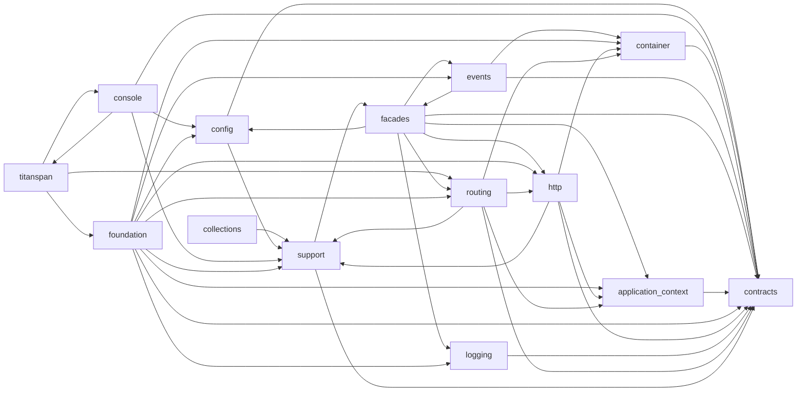

# Framework engineering review

## Scope and evidence

The historical source audit started at commit `2afcd31`. This continuation
reviewed main at `b2de4de`, including the integrated Hashing component. The
consolidation corrections below were developed from descendant main
`62bddf3` in an isolated worktree. The review keeps the original F findings
and adds dispositions for the C findings from the core-completion backlog.

The lockfile pins Blinker 1.9.0, Dishka 1.10.1, FastAPI 0.165.0, and
Starlette 1.10.0. It also pins HTTPX2 2.16.2, Pydantic 2.14.4, Pydantic
Settings 2.16.3, Structlog 26.1.0, Tenacity 9.2.1, and Typer 0.29.2. This
review checked the APIs in their installed versions.

## Assessment

The implemented components use one application-owned container and route
catalog. They delegate dependency graph execution, HTTP protocol handling,
network pools, path matching, settings validation, structured logging, and
retry scheduling to selected libraries. Their native adapters add Titanspan
contracts, security rules, lifecycle ownership, and application integration.

This is a coherent foundation for current configuration, logging, events,
HTTP, and routing use. The worker-thread singleton race documented below is
resolved by an earlier focused correction. This pass also corrected URL
contract substitution, encoded route reversal, and event subscriber scope
retention. Semantic scope nesting remains limited by the backend hierarchy
and affects future workflow architecture.

## Import dependency graph

An AST scan of 198 source files found 520 internal module edges and 43
cross-component pairs. A second scan excluded `TYPE_CHECKING` blocks and
function-local imports. It found 461 module-scope edges and no import-time
cycles.

The following graph aggregates the complete internal import references. An
arrow points from an importing component to its dependency.

The graph groups private modules under their owning components. The
`application_context` node represents the private shared context module.
`events.helpers` imports the Event facade for application-bound helpers.
`support.helpers.config` does the same for configuration access. Both imports
are function-local; they do not create module initialization cycles. The
Console-to-package edge reads installed version metadata.

## Component readiness matrix

The matrix separates production integration evidence from isolated unit
coverage. Each component specification lists implemented and pending
capabilities in more detail.

| Component | Integration evidence | Current assessment |
| --- | --- | --- |
| Contracts | `docs/src/content/docs/architecture/contract-integration.md`; Pyright and contract resolution tests | Native service boundaries exist for implemented components. Some protocols remain optional extension points. |
| Support | `tests/integration/support/`; URI and Routing integration tests | Reusable utilities work independently. Application-bound `config()` and route-aware URI factories require active services. |
| Config | Framework cohesion tests and Config specification | The repository is substitutable and Foundation-owned. Settings inheritance still exposes backend methods. |
| Logging | Framework cohesion tests and Logging specification | The manager, logger contracts, configuration, facade, and shutdown use one application identity. Several backend branches have lower local coverage than core APIs. |
| Container | Container thread-safety and lifecycle integration tests | One graph and shared initialization gates protect supported sync and async paths. Request/workflow and node/agent lifetimes cannot overlap. |
| Facades | Framework cohesion and URI contract substitution tests | Facades resolve declared application contracts. They do not own a second service registry. |
| Foundation | Lifecycle tests in `tests/integration/test_framework_cohesion.py` | Startup, failure rollback, context, active-scope shutdown rejection, and retryable shutdown have real tests. |
| HTTP | ASGI, client, streaming, and request lifecycle integration tests | Server and client adapters use application services. Native SSRF destination enforcement remains pending. |
| Routing | Dispatch, URI integration, and URL generator tests | One catalog drives matching and reversal. Native custom converters and route-file discovery remain unsupported. |
| Collections | Collection unit tests and Hypothesis invariants | Eager and lazy operations use Python iterators and preserve documented order. Intersection checks every supplied iterable. |
| Events | Events application and dispatcher integration tests | Dispatch uses the application Container. Class subscribers now resolve handlers in the active scope; Blinker currently stores receivers. |
| Console | CLI tests and Foundation integration | Native registration, Container injection, lifecycle, configuration, route, event, and artifact-generation commands are implemented. Full application scaffolding remains deferred. |

This evidence does not establish production readiness for distributed
execution, Windows, multiprocess pools, AI agents, or nested workflow scopes.

## Custom infrastructure review

| Component | Existing infrastructure | Custom behavior | Decision |
| --- | --- | --- | --- |
| Contracts | Python `Protocol`, `ABC`, and typing | Native service boundaries and domain values | Keep. These declarations provide dependency inversion and do not recreate engines. |
| Container | Dishka graph construction, validation, caching, and cleanup | Native bindings, discovery, contextual injection, overrides, scopes, and exception translation | Keep the adapter. Native policy adds framework behavior while Dishka retains graph and resource ownership. |
| Config | Pydantic Settings, `python-dotenv`, JSON, and TOML libraries | Repository semantics, source ordering, safe diagnostics, and cache validation | Keep. The repository and loader coordinate framework precedence and safe snapshots. Review the Settings inheritance exposure separately. |
| Logging | Structlog and Python logging handlers | Channels, redaction, context, bounded delivery, and application ownership | Keep. Titanspan owns policy and lifecycle; the backends own processing and sinks. |
| HTTP | Starlette, HTTPX2, AnyIO, and Tenacity | Native request and response contracts, body limits, client isolation, retry safety, and resource ownership | Keep narrow adapters. Do not duplicate parsing, pooling, scheduling, or ASGI transmission. |
| Routing | FastAPI and Starlette matching and route hosting | One route catalog, metadata, controller injection, URL generation, and constraints | Keep. The catalog supplies behavior that backend routes alone do not provide. |
| Events | Blinker receiver registry | Selectors, ordering, injection, sequential async dispatch, fakes, and bounded deferral | Keep native behavior; review Blinker’s limited role before API stabilization. |
| Collections | Python iterators, mappings, and equality operations | Ordered eager and lazy transformations, including unhashable values | Keep. Built-in sets cannot provide these ordering and equality guarantees. |
| Support | `urllib.parse`, `re`, `unicodedata`, `secrets`, and other standard modules | Native URI factories, nested data access, and composed string operations | Keep domain utilities. Avoid adding wrappers that only rename built-ins. Review three existing pass-through methods before the stable API. |
| Foundation | Starlette ASGI lifespan primitives and context variables | Application composition, provider order, request scope, and shutdown ownership | Keep. No selected dependency owns the complete Titanspan application lifecycle. |
| Facades | Active application context and Container | Explicit typed access to application-owned services | Keep the shared base. It delegates resolution and does not maintain another registry. |
| Console | Typer and Rich | Framework commands and output | Keep command integration; do not create another parser. |
| Test policy | Pytest and Vale | Category enforcement and Titanspan terminology rules | Keep the small checks. They enforce repository policies that the tools do not define. |

### Delegation corrections made during review

- HTTP retry scheduling now uses the existing Support helpers and Tenacity.
  HTTP-specific idempotency checks, status selection, and `Retry-After`
  handling remain in the HTTP component.
- The HTTP client now ignores response cookies in its shared cookie jar.
  Connection pools remain shared; cookie state does not cross requests.
- One bounded ASGI receiver now serves both the native Request and downstream
  ASGI application. This prevents a second protocol path from bypassing body
  limits.
- Stream iterators close before the request context exits after disconnect or
  cancellation. Starlette retains responsibility for ASGI transmission.
- Request builders snapshot mutable inputs. They do not create a second
  transport client or request execution engine.
- Routing continues to compile the canonical route catalog into FastAPI.
  Route constraints also apply to URL reversal and partial method matches.
- URL factories resolve one `UriUrlGenerator` contract. They share Support's
  query encoding and validate generated URLs against route matching.
- Class-based Event subscribers retain class and method metadata. Dispatch
  resolves each handler in its active execution scope.
- Collection intersection now checks membership in every supplied iterable.
  It retains first-seen order and supports unhashable values.
- Pytest collection rejects runtime tests without a recognized category.
  The check does not replace Pytest selection or coverage enforcement.

## Additional design review

### F-006 — Blinker is used as a receiver store, not the dispatch engine

**Severity:** P2 — design review; no behavior defect demonstrated.

**Affected components:** Events, dependency architecture.

**Evidence:** `src/titanspan/events/dispatcher.py:237` creates one
`OrderedSignal`. `dispatcher.py:275` connects every registration to that
signal. `dispatcher.py:918-931` reads all receivers, then Titanspan matches
selectors and orders listeners. The component does not call Blinker
`Signal.send()` or `Signal.send_async()`. `src/titanspan/events/_backends/blinker.py`
adds an ordered receiver set to retain registration order.

**Consequence:** Titanspan owns listener selection, ordering, injection,
results, propagation, and async execution. Blinker currently provides receiver
storage and connection operations. Its contribution may not justify the
adapter and dependency for this use.

**Recommendation:** Before stabilizing the Events API, compare this registry
use with a small ordered mapping. Keep Blinker only if receiver lifetime,
registration, or future signal delegation provides measurable value. Check
thread safety and removal during active dispatch before changing the design.

**Acceptance:** A focused proposal compares behavior, lock ownership,
registration cost, snapshot cost, and dependency impact. Tests preserve ordered
snapshots, removal during dispatch, independent applications, and concurrent
registration for the selected design.

## Resolved findings

### F-001 — Sync singleton initialization raced across worker threads

**Severity:** P1 — confirmed correctness defect, resolved in this change.

**Affected components:** Container, HTTP, Routing.

**Evidence:** Dishka 1.10.1 documents `AsyncContainer.get_sync`, but that
operation does not use the async getter's lock. The earlier native worker
path reached `get_sync` without shared initialization gates across graph
generations. Twenty concurrent synchronous ASGI requests then initialized one
application singleton twenty times.

**Reproduction:** Two real synchronous HTTP endpoints request the same
application singleton. Gate its factory with a two-party `threading.Barrier`
and issue both requests concurrently through `TestClient`. The factory ran
twice and returned different instances; both requests returned HTTP 200.

**Correction:** Application singleton dependencies are primed in
application-owned graphs before dependent roots. Per-service async gates span
all relevant graph generations. Worker-thread lookups return through the
owning AnyIO runtime, acquire those gates, and call the same backend cache.
Scoped gates use the owning execution scope, so unrelated requests remain
concurrent. An in-flight nested lookup through another graph fails with a
native error instead of creating a second instance.

**Implementation:** `src/titanspan/container/container.py:2123-2156`
coordinates asynchronous roots; `src/titanspan/container/container.py:2335-2389`
bridges worker calls; and `src/titanspan/container/container.py:2819-2915`
primes application-owned singleton dependencies. These paths use the gates
and cache owned by one Container.

**Verification:**
`tests/integration/test_container_thread_safety.py:552-595` retains the
twenty-request reproduction. The same integration module checks async and
mixed-mode contention, including both endpoint modes in one ASGI application
at `tests/integration/test_container_thread_safety.py:643-730`. It also checks
worker-thread lookups, transitive singletons, request isolation, retries,
cancellation, shutdown, and exact resource finalization.

**Result:** Sync and async resolution use one application backend cache and a
shared native initialization gate. Worker requests are not serialized at the
request level. The regression suite verifies the required one-owner behavior.

### F-008 — URL consumers bypassed the canonical contract

**Severity:** P2 — confirmed substitution defect, resolved in this change.

**Affected components:** Support, Routing, Container, Foundation.

**Evidence:** URI factories resolved `UriUrlGenerator`, but Routing helpers
and named redirects requested the concrete `UrlGenerator`. The old access
paths were in `src/titanspan/routing/helpers.py:155-159` and `:206-210`.

**Reproduction:** Override `UriUrlGenerator` with an alternate implementation.
Before correction, URI factories used the replacement while route helpers and
redirects resolved the concrete service.

**Correction:** Route helpers and `Redirector` now resolve the canonical
contract at `src/titanspan/routing/helpers.py:155-159` and `:206-210`. The
provider registers one generator under both keys at
`src/titanspan/routing/service_provider.py:61-70`.

**Verification:** `tests/integration/routing/test_uri_integration.py` checks
contract substitution across `Uri`, path helpers, action helpers, redirects,
and dependency injection. It also checks nested and concurrent application
contexts.

### F-009 — Named URL factories used inconsistent absolute defaults

**Severity:** P2 — confirmed API inconsistency, resolved with a documented
pre-release behavior change.

**Affected components:** Support URI factories, Routing helpers.

**Evidence:** `Uri.route()` and `Uri.action()` defaulted to absolute URLs at
`src/titanspan/support/uri.py:479-484` and `:558-563`; `route()` returned a
relative URL at `src/titanspan/routing/helpers.py:91-95`.

**Correction:** All named-route factories now return relative URLs by default.
Callers pass `absolute=True` to include the configured origin. `CHANGELOG.md`,
the URI guide, the Routing guide, and ADR 0021 document this change.

**Verification:** `test_named_url_factories_share_relative_default_policy`
checks the default and explicit absolute behavior.

### F-010 — Routing duplicated Support query encoding

**Severity:** P2 — confirmed behavior divergence, resolved in this change.

**Affected components:** Routing, Support URI utilities.

**Evidence:** Routing encoded repeated query values as duplicate keys and
spaces as `+` in its local `_encode_query()` helper. Support encoded nested
values with bracket indexes and RFC 3986 percent encoding.

**Correction:** URL generation delegates remaining values to `Arr.query` at
`src/titanspan/routing/url_generator.py:256-257`.

**Verification:** Unit and integration tests assert matching nested-array and
space encoding.

### F-011 — URL reversal did not validate all built-in converter values

**Severity:** P2 — confirmed route-generation defect, resolved in this change.

**Affected components:** Routing, HTTP.

**Evidence:** The baseline generator did not validate route converters and
skipped the backend reverser for typed converters. The first correction then
rejected `1e20`, although Starlette 1.10.0 accepts it and emits a matching
decimal path. A focused regression reproduced that edge case.

**Correction:** `src/titanspan/routing/url_generator.py:217-260` validates
constraints and delegates compiled reversal. Lines 449-535 normalize the
supported built-in converters. Unsupported custom converters fail explicitly.

**Verification:** `tests/unit/routing/test_url_generator.py` covers converter
acceptance and rejection. `tests/integration/routing/test_uri_integration.py`
dispatches an encoded Unicode URL through the real ASGI route and verifies a
compiled integer route against its generated absolute URL.

### F-012 — Class subscribers retained request-scoped dependencies

**Severity:** P1 — confirmed execution-scope isolation defect, resolved in
this change.

**Affected components:** Events, Container, application context.

**Evidence:** A class subscriber created in one request scope returned a
method name. `src/titanspan/events/dispatcher.py:579-613` stored
`ListenerReference(instance, method)` in its application-owned registry. A
later request invoked the first instance and received its dependency token.

**Reproduction:** `test_subscriber_class_resolves_listener_in_active_request_scope`
registers a class in one request and dispatches in a second. Before correction,
the second dispatch returned the first scope's token.

**Correction:** `src/titanspan/events/dispatcher.py:486-544` retains class
and method metadata for class-based subscribers. The Container resolves each
handler in the dispatch scope. An explicit instance remains registration-
owned and must have application lifetime.

**Verification:** The regression covers synchronous and asynchronous
subscription and dispatch. The complete Events unit and integration suites
pass after correction.

### F-013 — Route discovery ignored the effective application root

**Severity:** P2 — confirmed application bootstrap defect, resolved here.

**Affected components:** Foundation and Routing.

**Evidence:** `Application` constructed `RoutingServiceProvider` without its
resolved `ConfigManager.base_path`. `RouteDiscovery.from_configuration()`
therefore used the process working directory when `routing.path` was absent.

**Reproduction:** Place `routes/web.py` under a temporary `Application.base_path`
and request its route. Before correction, the application returned 404. A
relative `routing.path` also resolved from the process working directory.

**Correction:** Foundation passes the effective base path to the existing
Routing provider boundary. Discovery uses that path by default and resolves
relative overrides beneath it. Absolute overrides remain explicit.

**Verification:** `tests/integration/test_application_root.py` exercises
default and relative route roots through real application startup and ASGI
dispatch. `tests/integration/routing/test_route_discovery.py` preserves
explicit absolute-root behavior.

### F-014 — Validation failures had no native HTTP response

**Severity:** P2 — confirmed HTTP error-mapping defect, resolved here.

**Affected components:** Foundation, Validation, and HTTP.

**Evidence:** Foundation registered only the generic exception handler for
`ValidationException`. An uncaught request validation error was reported as
an application failure instead of a client input error.

**Reproduction:** Raise `ValidationException` from a real routed endpoint.
Before correction, the ASGI test logged it as unhandled and surfaced the
server exception instead of receiving a 422 response.

**Correction:** Foundation maps native validation issues to status 422 through
the canonical `ResponseFactory`. The response groups safe messages by field,
omits rejected input values, and permits application-specific handler
overrides.

**Verification:** `tests/integration/test_validation_exception_rendering.py`
uses the real Validation provider, request parser, Router, Container, and
response factory. It asserts the 422 status and confirms that input values do
not appear in the response.

### C-001 — Storage fakes bypassed injected manager consumers

**Severity:** P1 — confirmed isolation defect, resolved in this change.

**Affected components:** Filesystem, Facades, Contracts, Container.

**Evidence:** Before correction, `Storage.fake()` replaced disk selection only
inside the Storage facade. An injected `StorageManager` retained its direct
production disk path. Fake setup could also call `manager.disk()` while
validating a configured name, which constructed the production backend.

**Reproduction:** `tests/integration/test_filesystem.py::test_storage_fake_replaces_the_injected_manager_disk`
injects `StorageManager` into an application service and writes while the
facade fake is active. The test counts production filesystem factory calls.

**Correction:** The canonical `StorageDiskOverride` contract defines optional
context-local replacement. `FilesystemManager.disk()` checks its override
before constructing a backend. `Storage.fake()` installs and restores the
override through the injected manager. Custom managers without the capability
fail explicitly.

**Verification:** The injected service writes into the fake, the production
factory count remains zero, nested and sibling fake tests pass, and an
unsupported custom manager fails before disk access.

**Result:** Facade and injected storage consumers share one manager-owned
override. Configured disk caches and other applications remain unchanged.

### C-002 — Application-owned file resources used the process directory

**Severity:** P1 — confirmed application-isolation defect, resolved in this
change.

**Affected components:** Foundation, Filesystem, Logging.

**Evidence:** Relative local disk roots and file-log destinations were
interpreted without the active application's root. Two applications in one
process could therefore write into a shared current directory.

**Reproduction:** Filesystem and logging integration tests construct an
application under a dedicated root, change the process directory, and write
through the real application manager. The earlier implementation wrote
outside the selected application root.

**Correction:** Foundation registers the shared `ApplicationPaths` contract
before component providers. Filesystem anchors relative local roots to that
root. Logging anchors relative file destinations the same way. Absolute paths
remain unchanged; relative paths that escape the root fail during
configuration.

**Verification:**
`tests/integration/test_filesystem.py::test_relative_disk_roots_follow_each_application_root`
and the logging root, absolute-path, and traversal tests exercise separate
roots, working-directory changes, and configured destinations. Filesystem
unit tests cover absolute roots and path escape rejection.

### C-009 — Built-in component providers required repeated registration

**Severity:** P2 — confirmed framework composition gap, resolved in this
change.

**Affected components:** Foundation, Validation, Filesystem, Hashing.

**Evidence:** Applications could resolve these services only when callers
listed their providers in `service_providers`.

**Correction:** Foundation now registers Validation, Filesystem, and Hashing
providers with its core providers. One explicit provider of each type replaces
the default, preserving custom driver factories. Duplicate built-in provider
registrations fail before service registration.

**Verification:**
`tests/integration/test_framework_cohesion.py::test_application_registers_supported_component_providers_by_default`
resolves all three contracts through the real Application. Existing
Filesystem, Hashing, and Validation application tests verify explicit
provider behavior.

### C-016 — Framework diagnostics exposed exception text by default

**Severity:** P1 — confirmed secret-disclosure risk, resolved in this change.

**Affected components:** Console, Foundation, Logging.

**Evidence:** Console printed arbitrary exception text. Foundation passed the
exception object to logging, whose records retained its message and formatted
traceback, including chained causes.

**Reproduction:** Console and Foundation integration tests use synthetic
secret-bearing exceptions and chained causes. The earlier command output and
log record included the supplied secret.

**Correction:** Console reports command path and exception class by default.
`Console(show_exception_details=True)` explicitly enables bounded terminal
details. Foundation records exception type without text by default. The
application's `app.debug` value or `report_exception(include_details=True)`
explicitly enables detailed logs. This policy does not claim to redact every
possible secret from developer-selected detailed output.

**Verification:** `tests/unit/console/test_console.py` verifies safe default
output and explicit detail output. Framework integration tests verify safe
default logs, chained exception handling, explicit detail opt-in, and a real
ASGI request with generic 500 response. The post-shutdown fallback test verifies
that a closed logging manager emits a classified emergency record without
exception text.

### C-021 — Framework logging bypassed active service substitutions

**Severity:** P2 — confirmed service-identity inconsistency, resolved in this
change.

**Affected components:** Foundation, Logging, Facades, Container scopes.

**Evidence:** Foundation request middleware and exception reporting used a
manager captured during Application construction. `Log.fake()` and other
Container overrides selected another manager for ordinary service access.

**Correction:** Request middleware and exception reporting resolve the
manager from the active application execution scope. `Application.logging`
uses the active Container service and falls back to its captured owner only
after Container shutdown begins. Unhandled request reports retain the safe
request identifier when FastAPI handles the exception after request middleware
unwinds.

**Verification:**
`tests/integration/test_framework_cohesion.py::test_framework_exception_reporting_uses_safe_substituted_logging`
and `::test_asgi_exception_reporting_uses_request_scoped_log_context` verify
facade, direct Application, and real ASGI identity under `Log.fake()`.
`::test_application_reports_after_shutdown_without_leaking_exception`
verifies the lifecycle-owned emergency path after channel shutdown.

### C-003 — Validation diagnostics exposed backend messages and dynamic keys

**Severity:** P1 — confirmed secret-disclosure risk, resolved in this change.

**Affected components:** Validation, Foundation, HTTP, Routing.

**Evidence:** Pydantic errors omitted their input and context, but the adapter
returned backend-generated messages and locations. Custom validators can put
rejected values in messages. Typed mapping keys can also contain secrets.
Foundation did not register a dedicated FastAPI request-validation response.

**Correction:** `src/titanspan/validation/validator.py` maps known codes to
fixed messages, uses a generic message for unknown codes, and retains only
declared schema fields in locations. Untrusted dynamic keys become
`"<key>"`. Foundation renders `RequestValidationError` with a generic 422
body through the native response factory. Application-authored rule messages
remain public by design and are documented as trusted text.

**Verification:** `tests/unit/validation/test_validator.py` covers secret
values in validator messages and mapping keys. `tests/integration/test_validation_exception_rendering.py`
exercises native and FastAPI validation through real ASGI execution and checks
that synthetic secrets are absent from response bodies and logs.

### C-004 — HEAD requests consumed stream producers

**Severity:** P1 — confirmed side-effect and resource risk, resolved here.

**Affected components:** HTTP.

**Evidence:** The previous adapter suppressed body send messages after
Starlette had iterated the response body. A producer could perform unbounded
work or cause side effects for a HEAD request.

**Correction:** The private ASGI response adapter returns an empty response
with the original status, headers, and background task for HEAD and bodyless
statuses. It does not enter the stream producer.

**Verification:** `tests/integration/http/test_asgi_backend.py::test_head_stream_does_not_start_the_producer`
inspects actual ASGI messages and asserts the producer was not entered.

### C-005 — Route middleware changed response-model serialization

**Severity:** P2 — confirmed behavior inconsistency, resolved here.

**Affected components:** Routing, HTTP.

**Evidence:** Routes with middleware invoked a separate response path. Scalar
models lost JSON serialization and model filtering could differ.

**Correction:** The middleware path now applies FastAPI's response-model
adapter and JSON encoding before creating a native response. Explicit
Starlette responses keep FastAPI's bypass behavior.

**Verification:** `tests/integration/routing/test_dispatch.py::test_route_middleware_preserves_response_model_serialization`
compares scalar media types and Pydantic field filtering with and without
middleware through real ASGI requests.

### C-006 — None results failed for content-permitted statuses

**Severity:** P2 — confirmed response normalization defect, resolved here.

**Affected components:** Routing, HTTP.

**Evidence:** Routing passed every `None` result to `no_content()`, whose
contract only accepts bodyless status codes. Explicit 200, 201, and 202
therefore failed instead of returning an empty response.

**Correction:** Routing now creates an empty native response for ordinary
selected statuses. Its default remains 204. Explicit JSON null remains a
separate serialized representation.

**Verification:** `tests/integration/routing/test_dispatch.py::test_none_result_returns_an_empty_response_with_selected_status` covers
200, 201, 202, 204, 205, and 304. The adjacent JSON-null test verifies the
literal `null` body.

### C-007 — HTTP contracts omitted implemented native capabilities

**Severity:** P2 — confirmed substitution boundary gap, resolved here.

**Affected components:** Contracts, HTTP, Foundation.

**Evidence:** Native Request supported single and repeated uploads, but
`HttpRequest` did not declare them. Native responses supported cookie
mutation, but `HttpResponse` did not expose it to middleware.

**Correction:** Canonical contracts now expose upload metadata and bounded
async reads through `HttpUploadedFile`, plus response cookie creation and
removal through `CookieOptions`. Foundation delegates cookie operations to
Starlette and preserves separate `Set-Cookie` headers.

**Verification:** `tests/integration/http/test_contract_capabilities.py`
uploads multipart files through injected `HttpRequest` and mutates multiple
cookies through injected `HttpResponse` in a real application.

### C-013 — Hash verification accepted excessive work factors

**Severity:** P1 — confirmed resource-exhaustion risk, resolved here.

**Affected components:** Hashing.

**Evidence:** Backend verification parsed encoded Argon2 and Bcrypt costs but
did not enforce an application operational policy before expensive work.

**Correction:** `HashVerificationLimits` validates cost, encoded hash length,
password length, digest, and salt bounds. The backend rejects excessive PHC
and Bcrypt metadata before verification. Generation settings must fit the
selected verification policy. Defaults and hard ceilings are documented.

**Verification:** Hashing tests construct excessive metadata and patch backend
verification calls to fail if invoked. Configuration tests reject operational
limits outside their allowed bounds.

### C-014 — Hashing had no application-owned work limit

**Severity:** P2 — confirmed resource-control gap, resolved here.

**Affected components:** Hashing, Config, AnyIO integration.

**Evidence:** Async methods used AnyIO's process-wide worker limiter. Direct
synchronous calls did not share a configurable application budget. Argon2
replacement generation also bypassed any operation-level limit.

**Correction:** The built-in driver now owns one standard-library bounded
semaphore per application hasher. All synchronous and asynchronous hashing
operations use it, including replacement generation. Async calls still use
AnyIO's bounded worker pool. The shared semaphore is necessary because native
synchronous callers and AnyIO workers must consume the same capacity. Custom
drivers own their execution limits.

**Verification:** `tests/unit/hashing/test_hashing_manager.py::test_sync_and_async_hashing_share_application_work_budget`
uses controlled thread events to verify mixed-call contention. The rehash test
verifies that replacement generation uses the same budget. Configuration
tests cover defaults and invalid limits. UTF-8 byte-limit and invalid-Unicode
tests cover input boundaries. Redundant encoded-hash length validation was
removed from the private Argon2 parser because the public inspector checks it.

### C-015 — Replacement hashes appeared in result representations

**Severity:** P2 — confirmed diagnostic exposure, resolved here.

**Affected components:** Hashing, Contracts.

**Correction:** `HashVerification.replacement_hash` remains available for
explicit persistence but is excluded from the dataclass representation.

**Verification:** `tests/unit/contracts/test_hashing_contract.py::test_replacement_hash_is_not_exposed_by_result_representation`
checks both redaction and explicit field access.

## Core-completion backlog disposition

| Finding | Disposition at this source revision | Evidence or remaining boundary |
| --- | --- | --- |
| C-001 | Resolved | Injected StorageManager fake integration and nested override tests. |
| C-002 | Resolved for implemented paths | Routes, storage, file logging, configuration caches, event manifests, and Console artifacts use the effective application root. |
| C-003 | Resolved | Safe native and FastAPI 422 tests. |
| C-004 | Resolved | ASGI HEAD test proves no producer entry. |
| C-005 | Resolved | Real middleware response-model comparison. |
| C-006 | Resolved | Empty status and explicit JSON null tests. |
| C-007 | Resolved for current request and response contracts | Real injected multipart and cookie integration. |
| C-008 | Resolved for implemented request and connection lifecycles | Startup rollback, native handlers, streamed response failure after headers, and accepted WebSocket failure now have real lifecycle evidence. |
| C-009 | Resolved | Default Validation, Filesystem, and Hashing providers with explicit replacement tests. |
| C-010 | Resolved for declarative typed HTTP inputs | Route input rules use the canonical Validation service and the endpoint's OpenAPI schema. Imperative `validate_request` remains runtime-only by design. |
| C-011 | Resolved for route middleware | `MiddlewareDeclaration` carries parameters through aliases, groups, resources, and controllers. The Container resolves middleware. Startup rejects unsupported classes. Global middleware remains unparameterized. |
| C-012 | Resolved | Filesystem provider shutdown closes existing manager-owned backend instances and skips unused disks; `tests/integration/test_filesystem.py` covers partial startup and lazy shutdown. |
| C-013 | Resolved | Cost metadata is bounded before backend verification. |
| C-014 | Resolved | Built-in synchronous and asynchronous hashing share a bounded application-owned semaphore; `test_sync_and_async_hashing_share_application_work_budget` verifies contention. |
| C-015 | Resolved | Replacement hashes are omitted from ordinary representations. |
| C-016 | Resolved | Safe Console and Foundation diagnostics have regression coverage. |
| C-017 | Resolved for async programmatic execution | `Console.execute_async()` reuses an active app or owns a standalone lifecycle. Sync handlers use AnyIO worker threads. |
| C-018 | Resolved for supported generators | Installed-package smoke runs `make:controller`, imports its output, and dispatches the action through the native route. Full application scaffolding remains deferred. |
| C-019 | Resolved with C-009 | Built-in providers follow one deterministic Foundation registration policy. |
| C-020 | Resolved as a dependency decision | Hashing keeps direct `argon2-cffi` and `bcrypt` adapters; `pwdlib` was not added. |
| C-021 | Resolved | Framework-generated request and exception logs resolve active service substitutions. |
| C-022 | Resolved for the required installed application workflow | The wheel smoke covers route discovery, request isolation, validation, service fakes, Console, Testing, exception handling, and shutdown. It does not claim exhaustive installed-package API coverage. |

### C-022 — Installed reference application did not exercise cross-component paths

**Severity:** P2 — confirmed evidence gap, resolved for the required reference workflow.

**Affected components:** Foundation, Container, HTTP, Routing, Validation,
Filesystem, Events, Logging, Console, Testing, and package runtime checks.

**Evidence:** The installed wheel smoke covered the document workflow but did
not verify conventional route discovery, concurrent request scopes, or
application exception rendering. Source-tree integration tests could not
prove that these paths worked from an installed distribution.

**Correction:** The smoke creates a trusted `routes/web.py` module under its
temporary application root. It checks concurrent request-scoped identity,
the registered public exception renderer, and the generic unexpected-error
response and log record. The request-scope route compares injected resolution
with `app().make()` during overlapping requests.

**Verification:**
`tests/integration/test_runtime_application_smoke.py` asserts these results.
The installed wheel check runs `scripts/ci/runtime_smoke.py` from outside the
repository source path and verifies the installed `titanspan` command.

**Remaining boundary:** The smoke is one deterministic vertical slice. It does
not claim exhaustive per-component API coverage from an installed
distribution.

### C-010 — Typed route inputs did not apply application rules

**Severity:** P2 — confirmed integration gap, resolved for typed HTTP inputs.

**Affected components:** Validation, Routing, Foundation.

**Evidence:** Pydantic endpoint annotations generated request schemas and
safe backend 422 responses. Application rules only ran through explicit
Validation calls inside handlers, so a route could not declare both behaviors
through one native path.

**Correction:** `RouteDefinition.validate_input()` binds sync and async
application rules to an annotated endpoint parameter. FastAPI and Pydantic
retain request parsing and OpenAPI ownership. Routing resolves the canonical
`ValidationService` after route middleware continues to the endpoint. The
service's `apply_rules_async()` does not parse the schema again or read the
body. Routing does not create another validator.

**Verification:**
`tests/integration/validation/test_validation_application.py::test_route_applies_validation_rules_to_typed_request_body`
checks the generated request schema, sync and async rule failures, safe 422
responses, and middleware short-circuiting. The same test verifies malformed
schema input does not expose its rejected value. The startup test rejects
validation declarations on injected services.

**Boundary:** Explicit `Validation.validate_request()` calls remain
imperative. Routing cannot derive static OpenAPI schemas from calls made
inside endpoint code. WebSocket routes do not support HTTP input rules.

### C-008 — Exception lifecycle coverage was incomplete

**Severity:** P2 — confirmed verification gap; no lifecycle defect reproduced.

**Affected components:** Foundation, HTTP, Routing, Container.

**Evidence:** Existing integration tests covered safe request parsing,
validation, internal HTTP errors, injected native handlers, and startup
rollback. They did not assert behavior after HTTP headers or WebSocket
acceptance had been sent.

**Correction:** No runtime change was needed. Starlette propagates failures
after response transmission starts instead of sending a second HTTP response.
It also propagates accepted WebSocket handler failures to the ASGI host.
Foundation's outer lifecycle middleware restores application context, while
the owning HTTP or connection scope finalizes its resources.

**Verification:**
`tests/integration/http/test_request_lifecycle.py::test_stream_failure_after_headers_sends_no_second_response`
records actual ASGI messages and checks request context during generator
finalization. `tests/integration/routing/test_advanced_routing.py::test_websocket_failure_finalizes_scope`
checks the accept message, connection resource finalization, and context
restoration after a handler failure. Existing Foundation tests cover startup
rollback and injected exception handlers.

**Boundary:** Once HTTP headers or WebSocket acceptance are sent, Foundation
cannot replace the protocol response. The ASGI server owns connection
termination after an unhandled post-start failure.

### C-017 — Console lacked async programmatic execution

**Severity:** P2 — confirmed execution gap, resolved for registered commands.

**Affected components:** Console, Foundation, Container.

**Evidence:** `Console.run()` and `Console.invoke()` reject calls from an
active asynchronous runtime. The command execution operation was private, so
applications could not execute registered commands without starting a second
runtime or application graph.

**Correction:** `Console.execute_async()` accepts a registered command path
and typed Python values. It reuses the active Application context and its
Container. Outside an active context, it creates one Application through the
configured factory and owns startup and shutdown. Synchronous handlers still
run in AnyIO worker threads. Cancellation propagates through Foundation
cleanup. Invalid command paths and input keys raise `CommandInvocationError`.

**Verification:** `tests/integration/console/test_console_lifecycle.py`
checks active app, Container, injected output, and dependency identity;
standalone startup and shutdown; explicit exit status; invalid values; and
cancellation cleanup.

**Boundary:** `run()` and `invoke()` remain synchronous parser entry points.
`execute_async()` does not parse strings or coerce input values. Callers must
provide typed Python values for declared command arguments and options.

### C-018 — Installed artifact generation lacked runtime evidence

**Severity:** P2 — confirmed verification gap, resolved for supported generators.

**Affected components:** Console, Foundation, Routing, HTTP.

**Evidence:** Generator unit tests compiled template output, and integration
tests invoked generators through the source-tree package. The clean-install
smoke did not run an installed generator or dispatch its output.

**Correction:** The installed-package smoke creates an isolated application
root and invokes `python -m titanspan make:controller` with a fixed argument
vector. It imports the generated controller, registers its action through the
native Router, reverses its named route, and sends an ASGI request.

**Verification:** `tests/integration/test_runtime_application_smoke.py`
checks both the configured health route and generated controller response.
The CI installed-package job runs the same script outside the source tree.

**Boundary:** This verifies one generated artifact and its runtime path. Full
application scaffolding remains deferred because no maintained template
exists.

## Open findings

### F-002 — Request and workflow lifetimes cannot overlap

**Severity:** P2 — demonstrated architectural limitation.

**Affected components:** Container, Foundation, future Workflows and Agents.

**Evidence:** `src/titanspan/contracts/container/scope.py:13-16` documents
the shared levels. The Container maps request, connection, job, and workflow
to one level. `src/titanspan/container/container.py:4161-4172` assigns these
levels. `tests/unit/container/test_container.py:460-463` verifies that
workflow and request scopes cannot nest.

**Reproduction:** Enter `WORKFLOW`, then enter `REQUEST`; the Container raises
`ScopeError` because both scopes map to one backend level.

**Consequence:** A request cannot own or overlap a workflow scope in the same
container. Separate containers avoid nesting but do not share app singletons.

**Recommendation:** Before implementing workflow execution, decide whether
workflows need independently owned scopes alongside active requests. Keep the
current mapping until a real lifecycle requires that change.

**Acceptance:** Tests demonstrate overlapping request and workflow scopes,
deterministic cleanup, and shared application singletons, or public docs state
the supported restrictions.

### F-007 — Node and agent lifetimes cannot nest

**Severity:** P2 — demonstrated architectural limitation.

**Affected components:** Container, future Workflows and Agents.

**Evidence:** `src/titanspan/contracts/container/scope.py:13-16` maps node and
agent scopes to the same backend level. The Container rejects nested scopes
that do not advance that hierarchy at
`src/titanspan/container/container.py:4161-4172`.
`tests/unit/container/test_container.py:464-468` and `489-492` verify both
node-agent nesting orders. Lines 480-484 verify the tool-task conflict.

**Reproduction:** Enter `NODE`, then `AGENT`; the Container raises `ScopeError`.
The reverse nesting order fails for the same reason.

**Consequence:** One workflow cannot model an agent lifetime nested inside a
node, or a node lifetime nested inside an agent, with the current scopes.

**Recommendation:** Before implementing nested agents, decide whether node and
agent scopes need separate levels or independently owned child contexts.

**Acceptance:** Tests demonstrate nested agent/node isolation and cleanup, or
public documentation states the supported restrictions.

### F-003 — Public Settings inheritance exposes backend methods

**Severity:** P2 — confirmed encapsulation limit.

**Affected components:** Config, public API.

**Evidence:** `src/titanspan/config/settings.py:10-18` imports the private
backend and subclasses it. The private backend is Pydantic Settings, so its
inherited public methods remain visible on `config.Settings` instances.
`docs/specifications/backend-boundaries.md` records this limit.

**Consequence:** Application code can discover and depend on backend-specific
methods despite the native Settings API and private import path.

**Recommendation:** Keep the current typed subclass until a composition-based
settings API has a concrete design. Before stabilization, verify that the
replacement preserves subclass field typing, validation, environment sources,
and IDE completion. Do not merely rename the backend type.

**Acceptance:** Public type inspection exposes only documented Titanspan
operations, while native settings subclasses retain precise field types and
all existing source-precedence tests pass.

### F-004 — Three Str methods only forward to Python built-ins

**Severity:** P3 — low-value custom surface.

**Affected components:** Support.

**Evidence:** `src/titanspan/support/str.py:1031-1041` returns `len(value)`;
`src/titanspan/support/str.py:1075-1085` returns `value.lower()`; and
`src/titanspan/support/str.py:1560-1570` returns `value.upper()`.

**Consequence:** These methods add names and documentation without adding
behavior. Their maintenance cost is small, but they encourage custom wrappers
for ordinary Python operations.

**Recommendation:** Prefer `len(value)`, `value.lower()`, and `value.upper()`
in new Python code. Decide whether the `Str` namespace should be a complete
convenience API before stabilization. Preserve current exports until that API
decision is made.

**Acceptance:** New code uses Python built-ins unless a wrapper adds a
documented Titanspan behavior. Any later removal has an explicit API-change
record and migration note.

### F-005 — HTTP and Routing performance evidence

**Severity:** P2 — resolved for the workloads listed below.

**Status:** Resolved on the 2026-11-27 benchmark run. Measurements remain
machine-specific evidence, not production capacity claims.

**Affected components:** HTTP, Routing, future high-throughput workloads.

**Evidence:** `benchmarks/test_http_routing.py` exercises cold startup and
24-route compilation, warm ASGI dispatch, injected handlers, middleware,
pooled HTTPX2 and native Titanspan clients, bounded fan-out, and streamed or
buffered responses from a local HTTP/1.1 server. `benchmarks/README.md` records
the environment and results. On an Apple M2 with CPython 3.12.12, one noisy
run measured 3.483 ms median warm dispatch and 19.752 ms median for a 16-request
fan-out with concurrency four. The two-megabyte stream measured 308,600 traced
peak bytes; buffering the same response measured 4,214,800 bytes.

**Consequence:** The repository now has reproducible local measurements for
these workloads. Host activity made latency results unstable. They do not
establish cross-platform throughput or production capacity.

**Recommendation:** Keep the measurements informational. Repeat them on
stable, documented hardware before making capacity or performance claims.

**Acceptance:** Met for cold and warm route dispatch, pooled loopback HTTP,
bounded fan-out, and streaming memory. `make benchmark` includes the cases
without adding shared-runner timing thresholds.

## Writing validation

The final repository prose check reported 1,349 passive-voice advisories,
29 procedural sentence-length advisories, 38 descriptive sentence-length
advisories, and 3,557 spelling advisories. These findings are warnings. The
terminology rules and Vale regression suite remain blocking checks.

## Readiness

Configuration, logging, events, native request handling, and routing share
application services and lifecycle ownership. Their adapters delegate mature
protocol and execution engines. Verified fixes cover cookie isolation, bounded
request bodies, stream cleanup, URL constraints, middleware composition,
intersection semantics, URL contract substitution, and subscriber scope
isolation. Foundation now uses its effective root for route discovery and
renders native Validation failures as safe 422 responses.

Within one application container, singleton identity is shared across
concurrent synchronous, asynchronous, and worker-thread resolution. The
current scope map cannot overlap request and workflow lifetimes or nest node
and agent lifetimes. Resolve F-002 before implementing overlapping request and
workflow execution. Resolve F-007 before implementing nested agent and node
lifecycles. Treat F-003 as a public API design decision before stabilization.
Review F-006 before stabilizing Events. The Hello World example composes
configuration, logging, providers, dependency injection, and routing. It does
not yet exercise the full reference-application acceptance scenario or prove
execution from an installed wheel. Add that vertical slice before claiming
full framework cohesion. HTTP and Routing benchmarks are also absent, so no
performance advantage is established.
